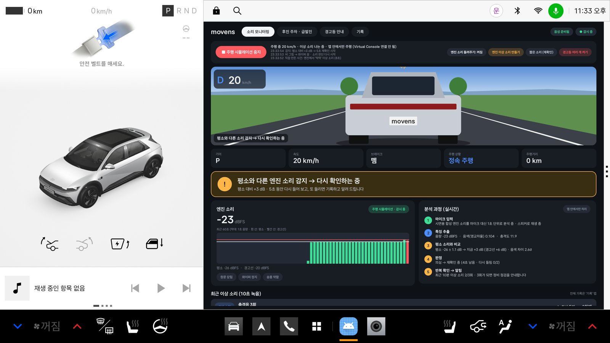
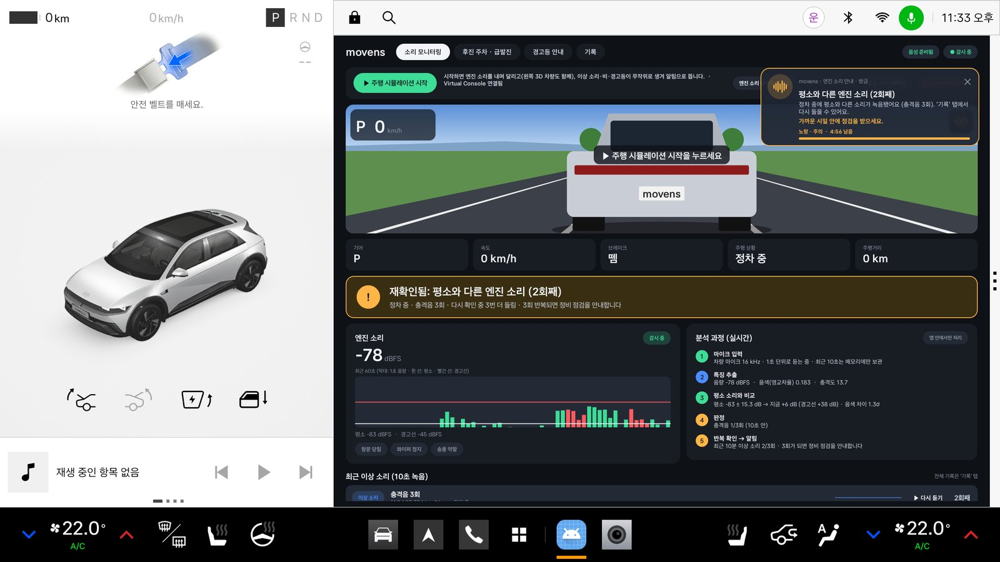
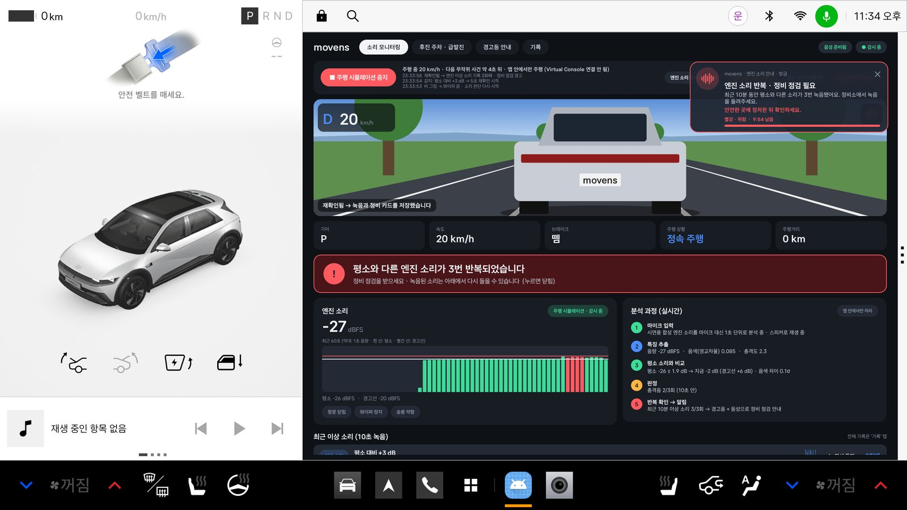
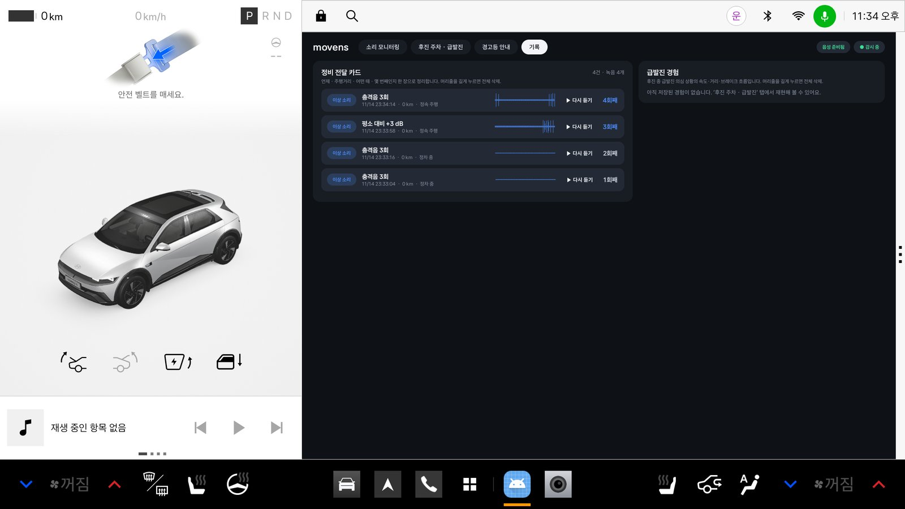
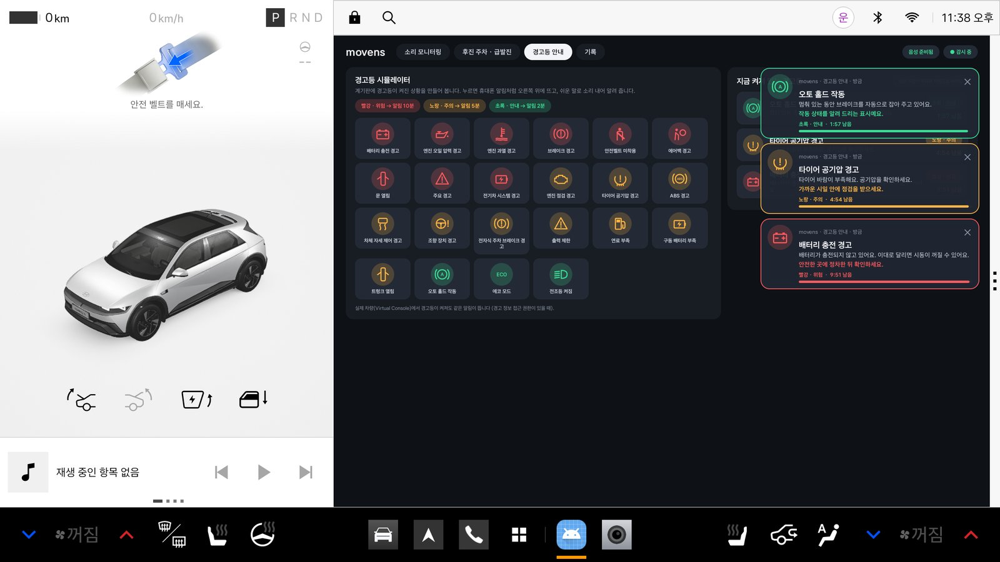
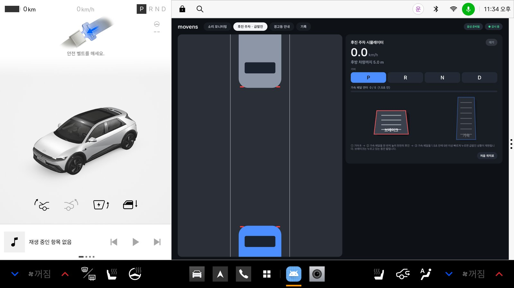

# movens

> **차가 평소와 다른 소리를 내면 그 순간의 조건과 함께 녹음해 정비소에 전달하고, 저속 페달 오조작과 경고등은 음성 한 문장으로 바로 알려 주는 운전 안전 앱.**
> 현대자동차그룹 차량용 앱 개발 공모전 출품작 (대학(원)생 부문) · Pleos Connect

**시작은 정비소였다.** 차에서 이상한 소리가 나서 정비소에 가면, 막상 그 자리에서는 소리가 나지 않는다.
운전자는 "언제, 어떤 조건에서 나는 소리인지" 말로 설명하기 어렵고, 소리가 점점 심해져도 스스로 알아차리기 어렵다. 불편의 핵심은 **소리가 났던 그 순간의 조건이 남아 있지 않다**는 점이다.
그래서 소리가 난 순간을 **속도 · 브레이크 같은 차량 신호와 함께 녹음해 두고**, 정비소에서 카드 한 장으로 보여 주는 것부터 시작했다. 최종 목표는 소리만으로 의심 부위를 추정하는 음향 진단이다.

여기에 사람이 흔히 실수하거나 어려워하는 두 순간을 더했다.
- **저속 페달 오조작** — 2025년 보도된 급발진 의심 사고 149건 중 109건(약 73%)이 페달 오조작으로 확인됐고, 69.4%가 정차 · 저속 중에 일어났다 ([한국교통안전공단 분석, 2026.1](https://magazine.hankyung.com/business/article/202601199742b)). 위험한 순간에 바로 알려 주는 경고가 필요하다.
- **경고등** — 영국 운전자 2,000명 설문에서 46%가 계기판 경고등의 절반도 알아보지 못했다 ([Motoring Research](https://www.motoringresearch.com/car-news/car-dashboard-warning-lights/)). 설명서는 경고등 이름을 알아야 찾을 수 있어 운전 중에는 쓰기 어렵다.

**▶ 시연 영상 (MVP, 2분 21초): https://youtu.be/JxV-zK6DK0A** — 이상 소리 기록(0:06) · 경고등 알림(1:04) · 정비 전달 카드(2:02). Pleos Connect Emulator에서 실제로 동작하는 화면을 녹화했다. 사전 개발 MVP라 화면 문구가 지금 버전과 조금 다를 수 있다.

**설계 원칙**
- 주행 중에는 짧은 음성 한 문장만 쓴다. 화면 안내와 기록 확인은 Pleos 주행 규제에 따라 정차한 뒤에 한다.
- 원인을 단정하지 않는다. 지금은 기록 · 알림 · 정비 전달까지 하고, 음향 진단은 정비 현장 데이터로 검증한 범위에서 단계적으로 더한다.
- 차량 제어에는 개입하지 않는다. 경고와 음성 안내로 운전자가 직접 대응하도록 돕는다.
- 소리만으로 판단하지 않는다. 창문 · 와이퍼 · 송풍 상태로 오탐을 줄이고, 속도 · 브레이크 상태로 "어떤 조건에서 났는지"를 남긴다.
- 소리와 주행 정보는 차량 안에서만 처리한다. 서버 전송이 없다.
- 검증되지 않은 정확도나 효과는 내세우지 않는다. "급발진 감지", "충돌 방지"라는 표현은 쓰지 않는다.

## 이렇게 써요

> 아래는 모두 **Pleos Connect Emulator 2.1.0에서 실제로 실행한 화면**이다 (목업 없음). 차량 상태는 Virtual Console로 바꿨다.
> 왼쪽은 차량 클러스터, 오른쪽이 movens다.

### 1. 평소와 다른 소리가 나면, 한 번 더 듣고 기록해요

앱을 켜 두면 실내 마이크 소리로 평소 기준선을 배우고(시연값 20초, 계획은 누적 2시간), 1초마다 음량 · 음색 · 충격음을 기준선과 비교한다.
벗어난 소리가 나도 바로 기록하지 않는다. **5초 동안 다시 들어 보고, 또 들려야** 10초 녹음과 정비 카드를 남긴다. 이때는 짧은 알림음만 낸다.
오른쪽 '분석 과정'에 마이크 입력 → 특징 추출 → 평소 소리와 비교 → 판정 → 반복 확인이 실시간으로 보인다.

| 의심 → 다시 확인 | 재확인됨 → 기록 |
|---|---|
|  |  |
| "평소와 다른 엔진 소리 감지 → 다시 확인하는 중" (주행 시뮬레이션: 합성 엔진 소리를 같은 분석 경로에 넣음) | 실제 마이크 입력으로 재확인된 장면. "재확인됨: 평소와 다른 엔진 소리 (2회째)" |

창문이 열려 있거나 와이퍼가 작동하거나 송풍이 강하면 그동안은 판단하지 않는다(화면 아래 '창문 닫힘 · 와이퍼 정지 · 송풍 약함' 칩).

### 2. 10분 안에 세 번이면, 점검을 권해요

최근 10분 안에 세 번째로 확인되면 음성 한 문장으로 알린다: "엔진에서 평소와 다른 소리가 반복되었습니다. 정비 점검을 받으세요." 원인은 단정하지 않는다.



### 3. 정비소에서는 카드로 보여 줘요

기록 탭의 정비 전달 카드에 **언제 · 주행거리 · 어떤 때(정차 중 / 정속 주행 …) · 내용 · n회째**가 한 줄로 남고, ▶ 다시 듣기로 그때의 10초 녹음을 들려줄 수 있다. 소리를 말로 설명할 필요가 없다. 카드는 앱 내부 저장소에만 있다.



### 4. 경고등이 켜지면, 쉬운 말로 읽어 줘요

경고등 22종을 쉬운 이름과 설명으로 읽어 준다. 색이 곧 위험도다 — **빨강(위험) 10분 · 노랑(주의) 5분 · 초록(안내) 2분** 동안 오른쪽 위 알림이 남는다. 여러 개가 한꺼번에 켜지면 가장 위험한 것을 기준으로 한 번에 묶어 안내한다.
예: "타이어 공기압 경고입니다. 타이어 바람이 부족해요. 공기압을 확인하세요. 가까운 시일 안에 점검을 받으세요."



### 5. 저속에서 페달을 잘못 밟으면, 바로 말해요

R 또는 D 기어, 15 km/h 이하에서 **브레이크 신호 없이 2초 안에 8 km/h 이상** 빨라지면 경고음과 함께 "브레이크를 밟으세요". 브레이크를 밟는데도 계속 빨라지면 "정차하세요"라고 말하고 신호 · 속도 · 기어 · 시각을 참고 기록으로 남긴다(공식 사고기록장치가 아니며 원인이나 과실을 판정하지 않는다). 크루즈 중에는 적용하지 않는다.
주행 중(5 km/h 초과)에는 Pleos 주행 규제로 앱 화면이 가려지므로 이 경고는 **음성으로만** 나오고, 정차하면 기록 탭에 "페달 경고" 카드가 보인다.

정차 중에는 **후진 주차 체험**으로 대처를 미리 연습해 볼 수 있다. 화면의 가속 페달을 1.5초 안에 5번 이상 누르면 페달 오조작 의심 상황을 재현하고, 속도 · 후방 거리 · 브레이크 반응 시간을 타임라인으로 남긴다.



## APK

**[GitHub Releases (최신)](https://github.com/movensfh-sys/movens/releases/latest)** — 켜진 Pleos Connect 에뮬레이터 창에 APK를 끌어다 놓거나:

```bash
adb install -r -g movens-v0.2.2-debug.apk
```

(`-g`: 권한 창 없이 자동 허용)

## 주요 기능

| 기능 | 내용 | 사용 신호 |
|---|---|---|
| 이상 소리 기록 | 실내 마이크를 1초 단위로 읽어 음량 · 영교차율 · 충격음 지표를 평소 기준선과 비교. 벗어나면 5초 재확인 후 10초 녹음 + 정비 카드. 1 · 2회째는 짧은 알림음, 최근 10분 안 3회째면 음성 점검 권고 | 마이크 · 창문/와이퍼/송풍(열림 · 작동 중엔 판단 안 함) · 속도/브레이크(어떤 때 났는지) |
| 저속 페달 오조작 경고 | R/D 기어, 15 km/h 이하에서 브레이크 없이 2초 안에 8 km/h 이상 → 경고음 + "브레이크를 밟으세요". 브레이크를 밟는데도 빨라지면 "정차하세요" + 참고 기록. 크루즈 중 미적용 | 기어 · 브레이크 · 크루즈(Vehicle SDK) · 속도(Car API) |
| 경고등 안내 | 22종을 쉬운 이름 · 설명으로 음성 안내. 색 = 위험도, 알림 유지 빨강 10분 · 노랑 5분 · 초록 2분. 동시에 켜지면 가장 위험한 것 기준으로 묶어 안내 | Safety.registerTelltales · Android 알림 |
| 정비 전달 카드 | "언제 · 주행거리 · 종류 · 어떤 때 · 내용 · n회째" 한 줄 + 10초 녹음. 앱 내부 저장소에만 저장 | 주행거리(Odometer) |
| 주행 시뮬레이션 (시연) | 마이크 대신 합성 엔진 소리를 **같은 분석 경로**에 넣는다. 20초 학습 뒤 엔진 이상 소리(노킹) · 비(와이퍼 → 판단 중지) · 경고등이 무작위로 일어나고, Virtual Console로 계기판 차량도 함께 움직인다 | 합성 소리 · Virtual Console |
| 후진 주차 체험 (시연 · 정차 중) | 가속 페달을 1.5초 안에 5번 이상 누르면 페달 오조작 의심 상황 재현, 속도 · 후방 거리 · 브레이크 반응 시간 타임라인 | 앱 안 시뮬레이터 |

## 테스트 환경 및 필요한 설정

| 항목 | 값 |
|---|---|
| 대상 | Android Automotive OS — **Pleos Connect Emulator 2.1.0** (API 34) + Virtual Console |
| 앱 | Kotlin 2.2.21, Android View, minSdk 28 / compileSdk 34, 패키지 `ai.movens.app` |
| SDK | Pleos `Vehicle:2.3.2`, `TextToSpeech:3.3.1`(ON_DEVICE), AAOS Car API `PERF_VEHICLE_SPEED` — 차량 속도는 Pleos SDK에 없어 공식 FAQ 안내대로 AAOS 표준 속성 사용 |
| 빌드 | Gradle 8.14.3 wrapper, AGP 8.10.1, JDK 17 이상, Android Studio Meerkat(2024.3.2) 이상 |
| 퍼미션 | `pleos.car.permission.CAR_DRIVE · CAR_WINDOWS · CAR_CLIMATE · CAR_SAFETY · PRIVATE_CAR_SAFETY · TTS_SERVICE`, `android.car.permission.CAR_SPEED · CAR_POWERTRAIN`, `RECORD_AUDIO`, `POST_NOTIFICATIONS`, `INTERNET`(Virtual Console 시연 전용) |
| 네트워크 · 계정 | 필요 없음 (TTS 온디바이스, 서버 없음) |

### 에뮬레이터 설치

1. Android Studio → Tools → SDK Manager → **SDK Update Sites** → `+`
   - Name: `Pleos Connect System Image`
   - URL (Windows/Linux): `https://nexus-playground.pleos.ai/repository/raw-releases/connect-avd/2.x/crp-sys-img.xml`
   - URL (Mac): `https://nexus-playground.pleos.ai/repository/raw-releases/connect-avd/2.x/crp-arm64-sys-img.xml`
2. SDK Platforms → API 34 → **Pleos Connect system image** 설치 후 Android Studio 재시작
3. Device Manager → Create device → **Automotive → Pleos Connect v2.1.0** → Boot **Cold**, RAM **4 GB**
4. 에뮬레이터 ⋮ → Microphone → "Virtual microphone uses host audio input" 켜기 (이상 소리 기록용). 스피커 소리를 마이크가 다시 들으면 이상 소리로 잡힐 수 있으니 헤드폰을 쓰거나 볼륨을 낮춘다.

에뮬레이터가 "Starting up"에서 멈추면 `%USERPROFILE%\.android\advancedFeatures.ini`에 `BluetoothEmulation = off`를 넣고 다시 켠다.

### Virtual Console (차량 상태 조작)

```bash
adb forward tcp:18088 tcp:8088
```

브라우저에서 `http://127.0.0.1:18088` → 카드로 차량 상태를 바꾼다. 브라우저 탭이 열려 있어야 동작한다. 페이지를 새로 열면 차량 상태가 기본값(창문 100 = 열림)으로 돌아가므로 소리 시연 전에 창문을 0으로 닫는다.

## 실행 방법

1. 에뮬레이터를 켜고 APK를 설치한다(위 `adb install`). 직접 빌드하려면 아래 "빌드".
2. movens를 실행한다. 처음 실행할 때 위치 · 마이크 · 알림 권한 창에서 모두 **허용**. 권한 창이 내비 뒤에 숨으면 몇 초 기다리거나 하단 바의 movens 아이콘을 다시 누른다.
3. 아래 순서대로 Virtual Console이나 앱 버튼으로 상황을 만든다.

| 시연 | 조작 | 앱 반응 |
|---|---|---|
| 이상 소리 | 창문 Window Position → 0, 20초 학습이 끝나 "감시 중"이 되면 노트북 근처에서 큰 소리를 내고 5초 안에 한 번 더 (`demo_sounds/`의 노킹 소리를 틀어도 됨) | 재확인 → 10초 녹음 + 카드 "이상 소리 · 정차 중 · 평소 대비 +n dB". 10분 안 3회째면 음성 점검 권고 |
| 오탐 억제 | Wiper → Low, 또는 Window → 50, 또는 Fan Speed → 5 이상 | 마이크 줄이 "일시 중지" |
| 페달 경고 | Gear Selection → R, ACCEL 버튼을 길게 눌러 속도를 올린다 | 경고음 + "브레이크를 밟으세요". 정차 후 카드 "페달 경고 · REVERSE …" |
| 경고등 | Safety → Telltales → TPMS On (또는 경고등 안내 탭의 타일) | "타이어 공기압 경고입니다 …" + 오른쪽 위 알림 |
| 주행 시뮬레이션 | 소리 모니터링 탭 → ▶ 주행 시뮬레이션 시작 (엔진 이상 소리 만들기 · 경고등 여러 개 켜기 버튼으로 바로 만들 수도 있음) | 20초 학습 뒤 노킹 · 비 · 경고등이 무작위로 일어남 |
| 후진 주차 체험 | 후진 주차 탭 → 기어 R → 가속 페달 한 번씩 → 1.5초 안에 5번 연타 → 경고가 나오면 브레이크 페달을 누르고 있기 | 기록 탭에 속도 · 거리 · 브레이크 반응 시간 타임라인 |

> 주행 중(5 km/h 초과)에는 Pleos 주행 규제로 3rd-party 앱 화면이 가려진다. movens는 이때 음성만 쓰고, 화면 안내와 카드는 정차 후에 보인다. 주행 시뮬레이션은 화면이 가려지면 계기판 기어를 P로 두고 속도만 보낸다.

## 빌드

```bash
./gradlew :app:assembleDebug
```

```bash
./gradlew :app:testDebugUnitTest
```

- 저장소는 **한글이 없는 경로**(예: `C:\dev\movens`)에 둔다. 한글 경로에서는 Android 빌드가 깨진다.
- "Please Select Gradle JVM" 창이 뜨면 **Use JVM 21** (JDK 25는 Gradle 8.14.3과 호환되지 않음).
- Gradle Sync 중 "AGP 업그레이드" 안내는 무시한다.
- 일반 폰 에뮬레이터에는 설치되지 않는다 (Automotive 전용).

## 구조

```
├─ app/src/main/java/ai/movens/app/
│  ├─ MainActivity.kt       # 차량 신호 구독 → 판단 → 출력 연결, 4개 탭(소리 모니터링 · 후진 주차 · 경고등 안내 · 기록)
│  ├─ PedalRule.kt          # 저속 페달 오조작 규칙 (순수 Kotlin)
│  ├─ Sound.kt              # SoundMonitor(마이크 1초 프레임, 최근 10초 링버퍼) · AnomalyDetector(기준선 · 이상 판단)
│  ├─ Telltales.kt          # 경고등 22종 사전(쉬운 이름 · 설명 · 위험도) · 알림 센터
│  ├─ Cards.kt              # 정비 전달 카드 (JSON Lines, 앱 내부 저장소)
│  ├─ Speaker.kt            # Pleos TextToSpeech(ON_DEVICE) + 경고음
│  ├─ Ui.kt                 # 고대비 차량용 화면 요소, 음량 그래프
│  ├─ DriveSim.kt           # (시연) 합성 엔진 소리 · 무작위 사건
│  ├─ DriveSceneView.kt     # (시연) 주행 장면
│  ├─ ReverseSim.kt         # (시연) 후진 주차 체험
│  └─ VirtualConsole.kt     # (시연) 에뮬레이터 Virtual Console 연동
├─ app/src/test/            # 단위 테스트 22개 (PedalRule, AnomalyDetector, DriveScenario, ReverseSimModel)
├─ demo_sounds/             # 마이크 시연용 소리 (평소 엔진 30초, 노킹 60초, 합본)
└─ docs/img/readme/         # README 화면 (에뮬레이터 실제 실행 화면)
```

## 개발 범위

| 단계 | 내용 |
|---|---|
| **1차 MVP (구현 완료)** | 저속 페달 오조작 경고, 이상 소리 기록(재확인 포함), 경고등 22종 음성 · 화면 안내, 정비 전달 카드, 시연용 주행 시뮬레이션과 후진 주차 체험 |
| **2차 (2차 PT 전까지)** | 기준선 학습을 시연용 20초 → 누적 2시간, 속도 구간 · 주행 상태별 기준선 / FFT 대역별 에너지 추가 / 임계값 확정 / 경고등 문구 · 위험도를 제조사 매뉴얼 기준으로 검수 / 주행 중 화면이 가려진 동안에도 마이크 분석이 이어지도록 마이크 유형 포그라운드 서비스 / 정비소 길 안내(NaviHelper SDK, 내비게이션 탑재 차량) / 음성인식 · 통화 · 미디어 재생 중 판단 억제 |
| **추후 (소리 분석 고도화)** | 오토인코더 기반 소음 필터링(도로 · 바람 · 음악 · 대화 제거), 음향 진단(이상 소리 + 정비 결과 학습으로 의심 부위 추정, 정비 현장 검증 범위에서만 참고 정보로 제공) |
| **확장 (검토)** | 어린이 보호구역 안내(FusedLocation SDK, 지원 차량), Gleo AI 음성 명령 연동(Gleo Interface), 제동 개입의 간접 방안(앱이 차량 제동을 직접 제어할 수 없으므로 가능한 간접 방법을 찾아 검토) |

## 기술 가정과 알려진 제한

- **마이크:** 에뮬레이터에서는 호스트 마이크 입력으로 동작한다. 실차 접근 가능 여부는 아직 확인하지 못했다. 주행 중 화면이 가려진 동안에는 Android가 백그라운드 앱의 마이크 입력을 막으므로 포그라운드 서비스가 필요하다 (2차).
- **경고등 권한:** `registerTelltales`는 `PRIVATE_CAR_SAFETY`가 필요하다. 에뮬레이터에서는 허용되지만 App Market 심사 허용 여부는 별도 확인이 필요하다. 거부되면 경고등 기능만 꺼지고 나머지는 동작한다.
- **제동:** 앱에서 차량 제동을 직접 제어할 수 없다. 경고음과 음성 안내로 운전자가 직접 브레이크를 밟도록 유도한다.
- **소리 판단:** 상대 데시벨은 절대 소음이 아니므로 "평소 대비 변화"만 판단한다. 임계값(15 km/h, 8 km/h, 2초, +6 dB 등)은 시뮬레이션으로 조정할 초기값이다.
- **Virtual Console 연동:** `INTERNET` · `127.0.0.1:8088` 평문 통신은 에뮬레이터 시연 전용이다. 실차에는 이 서버가 없어 연결이 안 되면 앱 안 시뮬레이션만 한다.

## 라이선스

[MIT](LICENSE)
